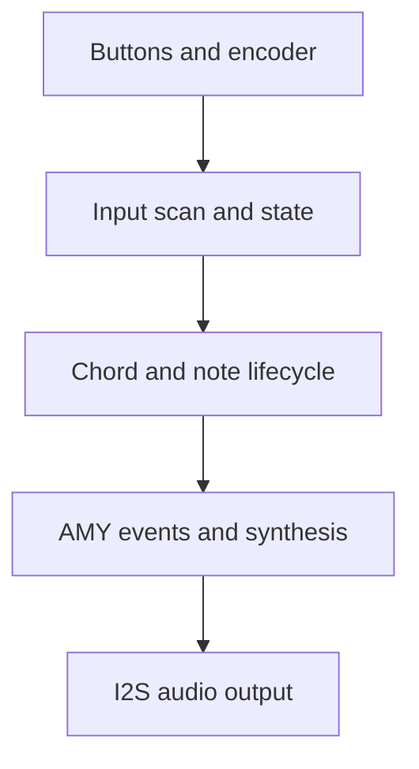

# Chord Synthesizer

This ESP32 / AMY instrument prototype maps physical controls to multi-note harmony. The engineering question is how to make richer chords immediately playable while keeping input handling, sounding notes and a limited synthesis budget understandable.

**C++ / C · ESP32 · AMY · I2S · Physical controls**

## What the reviewed firmware contains

The inspected control-surface version reads note, modifier and setting buttons plus a rotary encoder through chained input shift registers. It sends note events to AMY and configures I2S output. Note presses select diatonic chords; modifiers alter chord quality, settings change octave or patch, and the encoder adjusts volume and mute.

It supports seventh- and ninth-chord construction in source. Only one chord is active at a time in this version, while multiple notes within that chord sound together. Pressing a new chord stops the previous chord. This distinction keeps the description precise: multi-note chord synthesis does not imply overlapping independently held chords.

## Design under constraints

| Constraint | Choice in the reviewed version | Tradeoff |
| --- | --- | --- |
| Many controls on limited GPIO | Serial shift-register input scanning | Polling and encoder transitions need hardware validation |
| Finite synthesis resources | Limit active harmony and stop previous notes before a replacement | Prior held chords do not keep sounding |
| Changing harmony while playing | Explicit stop / start note lifecycle | Transitions need an audible release and click check |
| Switch bounce | Time-gated changes in firmware | This is not the same as requiring a continuously stable input interval |

## Responsibility map

## Code example

A [standalone debounce example](https://github.com/gabriel-senra/engineering-examples) demonstrates stable-interval filtering and unsigned clock rollover in hardware-independent C++. It was prepared separately from the firmware and uses a different debounce strategy.

The private harmony module also passed 5,376 host-side valid-domain checks added during this review. Those checks exercise note-count bounds, MIDI range and output-buffer sentinels; they do not validate AMY integration, sound quality, wiring or real-time performance.

## Current limits

The archives include desktop and multiple firmware experiments. This page describes the inspected control-surface source, not a claim that every version is combined in one tested device. OLED work appears in an earlier firmware version and is deliberately not attributed to this surface version. No voice-capacity, CPU, memory or latency benchmark is claimed from comments alone.

Full firmware, voicing tables, interaction system, patches and hardware product designs remain private.
